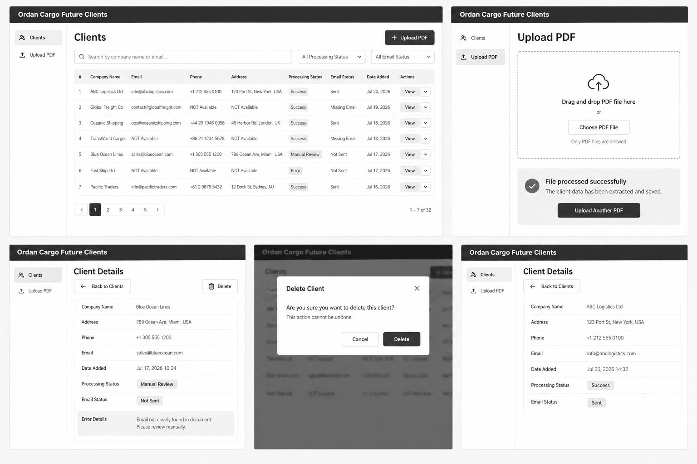
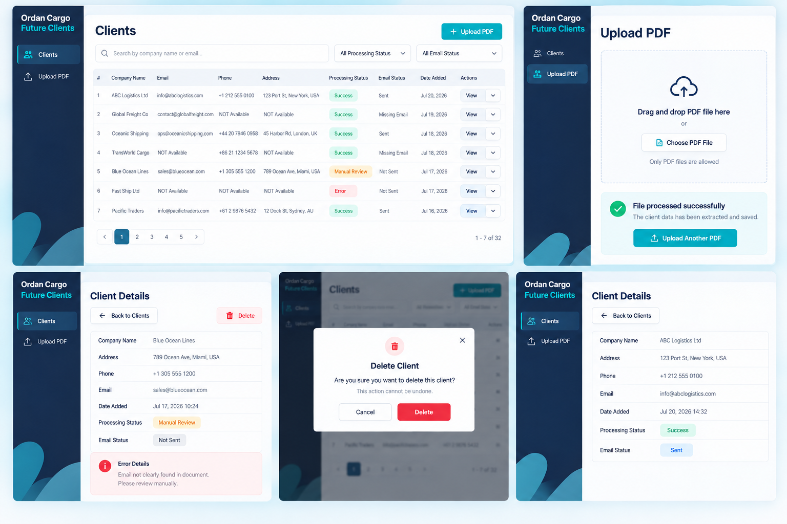
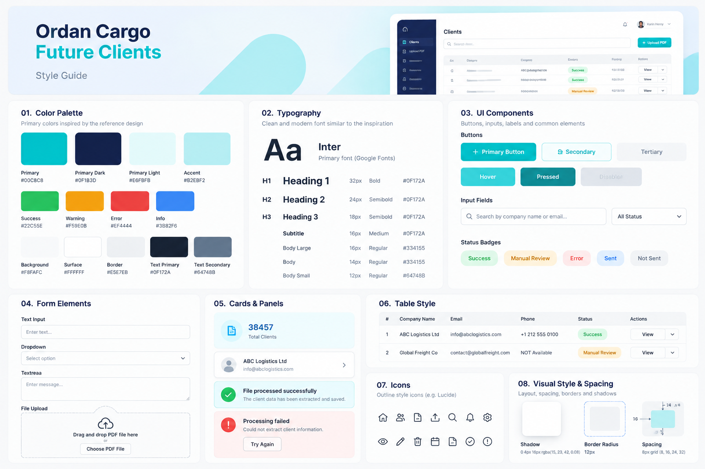

# DESIGN — Ordan Cargo Future Clients

מסמך זה מגדיר את עיצוב האפליקציה על בסיס שלושת חומרי הייחוס:
- **Wireframes:** מקור האמת למבנה ולפריסה.
- **Mockups:** המראה הסופי.
- **Style Guide:** השפה החזותית.

המוצר מיועד ל-Desktop Web, והממשק באנגלית.

> **התמונות הן המחשה.** כשיש סתירה בין התמונות לבין ה-PRD לגבי שדות, סטטוסים, פעולות או טקסטים, **ה-PRD קובע**. ראה גם סעיף 1.6.

## תמונות ייחוס

### Wireframes


### Mockups


### Guide Style


---

# 1. Screens

## 1.0 מעטפת קבועה (App Shell)
- **סרגל ניווט קבוע בצד שמאל**, ברקע Navy, כמו ב-Mockups.
- בראש הסרגל מוצג שם המערכת: **Ordan Cargo Future Clients**.
- פריטי הניווט: **Clients** ו-**Upload PDF**, עם אייקון לכל פריט. הפריט הפעיל מודגש.
- אזור התוכן מימין לסרגל, על רקע בהיר.
- הגישה למערכת מוגנת בחלון הסיסמה המובנה של הדפדפן. אין מסך Login מעוצב.

## 1.1 Clients

### מטרה
מסך הבית. המשתמש צופה ברשימת הלקוחות, מחפש ומסנן, בודק את ה-Processing Status ופותח לקוח לצפייה מפורטת.

### מה יש במסך
- כותרת **Clients**, וכפתור Primary **Upload PDF** בצד ימין למעלה.
- שדה Search עם הטקסט `Search by company name, email or phone`.
- Dropdown לסינון: `All Processing Status`, `Success`, `Failed`.
- כפתור **Refresh**.
- טבלת לקוחות עם העמודות: **Company Name**, **Email**, **Phone**, **Date Added**, **Processing Status** ו-**Actions**.
  - בעמודה **Actions** מופיע כפתור **View** בלבד.
  - כותרת העמודה **Date Added** לחיצה, ומחליפה את המיון בין החדשים ראשונים לישנים ראשונים. חץ ליד הכותרת מציין את הכיוון.
- Status Badges.
- Pagination מתחת לטבלה, עם כפתורי **Previous** ו-**Next** בלבד. הכפתור מושבת כשאין עמוד קודם או הבא.
- ערכים חסרים מוצגים כ-`NOT Available`.
- Date Added מוצג בפורמט `Jul 20, 2026`.
- מצב ריק: `No clients found.`

### מה קורה במסך
לחיצה על **View** או על שורה פותחת את **Client Details**. לחיצה על **Upload PDF** עוברת למסך ההעלאה.

---

## 1.2 Upload PDF

### מטרה
העלאת House Bill of Lading (HBL) כ-PDF, והפעלת העיבוד האוטומטי.

### מה יש במסך
- כותרת **Upload PDF**.
- אזור Drag & Drop גדול עם Upload icon, הטקסט **Drag and drop PDF file here**, הכפתור **Choose PDF File** והטקסט `Only PDF files are supported. Maximum size: 4 MB.`
- Processing indicator בזמן העיבוד: spinner והטקסט `Processing...`. בזמן העיבוד אזור ההעלאה מושבת.
- הודעת תוצאה ב-Card מתחת לאזור ההעלאה, בסגנון של כרטיסי ההודעה ב-Style Guide.

| תוצאה | סגנון | טקסט |
|---|---|---|
| לקוח נוסף עם `Success` | Success (ירוק) | `Client added successfully.` |
| כפילות | Info (כחול) | `Client already exists. No changes were made.` |
| נדרש טיפול ידני, וההתראה נשלחה | Warning (Amber) | `File processed. Manual review required — details were sent by email.` |
| נדרש טיפול ידני, ושליחת ההתראה נכשלה | Error (אדום) | `Manual review required, but the notification email could not be sent. Please review the file manually.` |
| הקובץ אינו PDF | Error | `Only PDF files are supported.` |
| הקובץ גדול מדי | Error | `File is too large. Maximum size is 4 MB.` |
| כשל טכני | Error | `Something went wrong. Please try again.` וכפתור **Try Again** |

### מה קורה במסך
בחירת PDF או גרירתו מתחילה את העיבוד אוטומטית. בסיום נשארים במסך, ואזור ההעלאה זמין שוב. העלאה חדשה מחליפה את ההודעה הקודמת.

---

## 1.3 Client Details

### מטרה
להציג את כל המידע על לקוח, להבין את מצב העיבוד, ולאפשר עריכה או מחיקה.

### מה יש במסך
- כותרת **Client Details**.
- **Back to Clients** בצד שמאל, ו-**Edit** (Secondary) ו-**Delete** (Destructive) בצד ימין.
- Card של פרטי הלקוח: Company Name, Address, Phone, Email.
- Card נפרד של פרטי המשלוח, תחת הכותרת **Shipment Details**: Origin Port, Origin Country, Destination Port, Incoterms, Shipment Type.
- Card של מצב הרשומה: Date Added בפורמט `Jul 20, 2026 14:32`, ו-Processing Status כ-Badge.
- Panel של **Error Details** ברקע אדום בהיר, כמו ב-Mockups. מוצג רק כשהסטטוס הוא `Failed`.

### מצב עריכה
- כל שדות הלקוח ושדות המשלוח הופכים ל-Inputs. **Shipment Type** הוא Dropdown עם הערכים `FCL`, `LCL` ו-`NOT Available`.
- הכפתורים **Edit** ו-**Delete** מוחלפים ב-**Save** (Primary) וב-**Cancel** (Secondary).
- אחרי **Save** מוצגים הערכים המעודכנים והסטטוס המחושב מחדש.
- כפילות: Alert אדום מעל הטופס עם `A client with this company name and email already exists.` הטופס נשאר במצב עריכה.

---

## 1.4 Delete Client Confirmation

Modal מעל Client Details, לא יעד ניווט נפרד:
- אייקון פח באדום וכותרת **Delete Client**.
- הטקסט **Are you sure you want to delete this client?**
- הטקסט המשני **This action cannot be undone.**
- **Cancel** (Secondary), **Delete** (Destructive) ו-Close (X).

**Cancel** או Close סוגרים את ה-Modal ללא שינוי. **Delete** מוחק את הלקוח וחוזר ל-Clients.

---

## 1.5 ניווט בין המסכים

```text
Sidebar: Clients | Upload PDF
Clients
├── Upload PDF  → בסיום נשארים ב-Upload PDF
└── Client Details
    ├── Edit → Save / Cancel
    ├── Delete → Delete Confirmation → Clients
    └── Back to Clients
```

---

## 1.6 מה מופיע בתמונות ואינו נבנה

הרכיבים הבאים מופיעים בתמונות להמחשה בלבד, ו**אין לממש אותם**:
- עמודות `#` ו-**Address** בטבלת Clients. Address מוצג רק ב-Client Details.
- כפתור ה-dropdown (chevron) ליד **View**.
- **Email Status**: לא בעמודה, לא בסינון ולא בפרטי הלקוח.
- תוויות הסטטוס `Manual Review`, `Error`, `Sent` ו-`Not Sent`. הסטטוסים היחידים הם `Success` ו-`Failed`.
- מספרי עמודים בתחתית הטבלה, וספירה בסגנון "1 - 7 of 32".
- הכפתור **Upload Another PDF**, והטקסט "The client data has been extracted and saved."
- מה-Style Guide: Card של Total Clients, פעמון התראות, אווטאר משתמש, כפתור Tertiary ו-Textarea.

---

# 2. Guide Style

## 2.1 שפה ואווירה
מערכת SaaS עסקית, מודרנית, נקייה ומקצועית: בסיס לבן ובהיר, Navy כהה לסרגל הניווט ולמבנה, ו-Teal/Cyan לפעולות ולמיתוג. הרבה whitespace, היררכיה ברורה, Cards בהירים ו-Status badges קלים לסריקה.

## 2.2 Color Palette

| שימוש | HEX |
|---|---|
| Primary / Teal | `#00C8C8` |
| Primary Dark / Navy | `#0F1B3D` |
| Primary Light | `#E6FBFB` |
| Accent | `#B2EBF2` |
| Success | `#22C55E` |
| Warning | `#F59E0B` |
| Error | `#EF4444` |
| Info | `#3B82F6` |
| Background | `#F8FAFC` |
| Surface | `#FFFFFF` |
| Border | `#E5E7EB` |
| Text Primary | `#0F172A` |
| Text Secondary | `#64748B` |

Navy משמש לסרגל הניווט ולטקסט חזק, ו-Teal לפעולה הראשית. צבעי Success, Warning, Error ו-Info משמשים לסטטוסים ולהודעות. Delete מובחן באדום.

## 2.3 Typography
הגופן המרכזי: **Inter**.

| סגנון | גודל | משקל |
|---|---:|---|
| H1 | 32px | Bold |
| H2 | 24px | Semibold |
| H3 | 18px | Semibold |
| Subtitle | 16px | Medium |
| Body Large | 16px | Regular |
| Body | 14px | Regular |
| Body Small | 12px | Regular |

טקסט ראשי בצבע `#0F172A`. טקסט משני ו-placeholders בצבע `#64748B`.

## 2.4 Buttons
- **Primary:** רקע Teal, טקסט לבן, פינות מעוגלות, ואפשרות ל-outline icon.
- **Secondary:** רקע לבן, border עדין וטקסט Navy או Teal.
- **Destructive:** אדום עם טקסט לבן, רק לפעולות הרסניות. בעמוד Client Details הכפתור **Delete** מוצג כ-outline אדום, כמו ב-Mockups, וב-Modal כאדום מלא.

לכל כפתור יש מצבי Default, Hover, Pressed ו-Disabled, באותה משפחת צבעים.

## 2.5 Inputs, Search ו-Filters
רקע לבן, border דק `#E5E7EB`, פינות מעוגלות וגובה עקבי. ב-Search יש אייקון זכוכית מגדלת, וב-Dropdown יש chevron. Focus מקבל הדגשת Teal עדינה.

## 2.6 Tables
Surface לבן, Header בהיר, קווי הפרדה עדינים, padding נוח וטקסט קומפקטי. הסטטוסים מוצגים כ-badges, וה-Pagination מתחת לטבלה. אין לצבוע שורות שלמות בצבעים חזקים.

## 2.7 Status Badges
Pills קטנים:
- `Success`: ירוק.
- `Failed`: אדום.

הסטטוס תמיד מופיע גם כטקסט, ולא רק כצבע.

## 2.8 Cards, Panels והודעות
- **Cards ו-Panels:** רקע לבן, border עדין, פינות מעוגלות, padding נדיב וצל חלש.
- **הודעות:** רקע צבעוני בהיר מאוד, אייקון מתאים וטקסט ברור. Success משתמש ב-Check, Warning ו-Error ב-Alert, ו-Info ב-Info icon.

## 2.9 File Upload
אזור ההעלאה הוא Card גדול עם border מקווקו, פינות מעוגלות, Upload icon, טקסט פעולה מרכזי, הכפתור **Choose PDF File** והרבה whitespace.

## 2.10 Icons
Outline icons דקים בסגנון Lucide: Users, Upload, Search, Refresh, ArrowLeft, Pencil, Trash, Check, AlertTriangle, Info ו-X.

## 2.11 פינות, צורות וצללים
Cards ו-Panels עם border radius של `12px`. בתחתית סרגל הניווט יש צורות מופשטות מעוגלות בגווני Teal, כמו ב-Mockups.

```css
box-shadow: 0 4px 16px rgba(15, 23, 42, 0.08);
```

## 2.12 Spacing
**8px grid**, עם הערכים `8px`, `16px`, `24px` ו-`32px`:
- **8px** בין רכיבים קטנים וקשורים.
- **16px** בין controls סמוכים.
- **24px** בין קבוצות תוכן.
- **32px** ומעלה בין אזורים מרכזיים.

## 2.13 היררכיה חזותית
1. כותרת המסך.
2. הפעולה הראשית.
3. התוכן המרכזי.
4. Statuses.
5. פעולות משניות.
6. טקסטי הסבר ו-metadata.

## 2.14 עקרונות UX
- Clients הוא מסך הבית.
- הניווט בסרגל הצד קצר ועקבי.
- בזמן Processing תמיד מוצג feedback.
- Status מזוהה באמצעות טקסט וצבע.
- Delete תמיד דורש Confirmation.
- Error Details מוצג רק כשהסטטוס הוא `Failed`.
- מידע חסר מוצג כ-`NOT Available`.
- אין להוסיף מסכים או פעולות שאינם ב-PRD.
